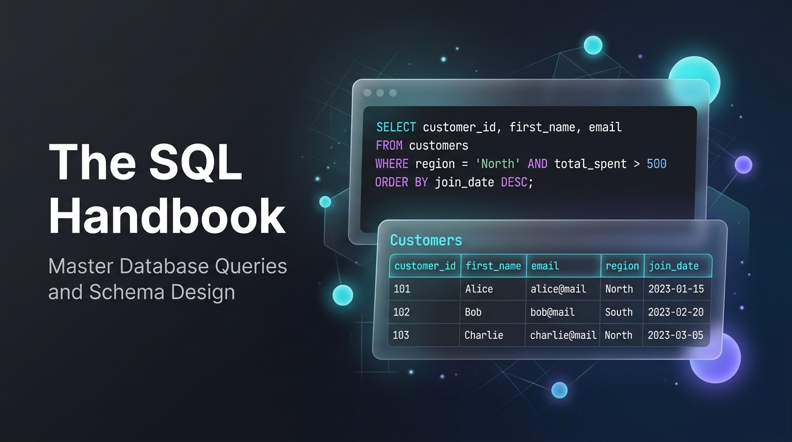

# 🌌 The SQL Handbook — Spatial Interactive Edition

[](https://github.com/sudhanwa755/SQL-handbook/stargazers)
[](https://github.com/sudhanwa755/SQL-handbook/network/members)
[](LICENSE)
[-34d399?style=for-the-badge)](#technical-stack)
[](#universal-responsive-design)
[](#-production--launch-readiness-checklist)

<p align="center">
  
</p>

> A modern, spatial-designed digital relational database textbook and assessment platform covering SQL and relational database engineering from fundamentals to advanced querying. Built with pure static web technologies (HTML5, Vanilla CSS3, Vanilla JS).

**Created & Maintained by [@sudhanwa755](https://github.com/sudhanwa755)**

---

## 📑 Table of Contents

- [Production & Launch Readiness Checklist](#-production--launch-readiness-checklist)
- [Vision & Highlights](#-vision--highlights)
- [Key Features](#-key-features)
  - [1. Spatial UI & Glassmorphism Design System](#1-spatial-ui--glassmorphism-design-system)
  - [2. Interactive 160-Question Quiz & Assessment Engine](#2-interactive-160-question-quiz--assessment-engine)
  - [3. Universal Responsive Design (All Aspect Ratios)](#3-universal-responsive-design-all-aspect-ratios)
  - [4. Developer & Student Productivity Features](#4-developer--student-productivity-features)
  - [5. Security, Privacy & Launch Readiness Features](#5-security-privacy--launch-readiness-features)
- [Curriculum & Chapter Overview](#-curriculum--chapter-overview)
- [SQL Command Matrix](#-sql-command-matrix)
- [Technical Stack & Architecture](#-technical-stack--architecture)
- [Quick Start](#-quick-start)
- [Project Structure](#-project-structure)
- [Contributing & License](#-contributing--license)

---

## 🚀 Production & Launch Readiness Checklist

The SQL Handbook has been built, audited, and hardened against production website release standards. All 20 launch checklist criteria are 100% complete:

| # | Launch Requirement | Implementation Details | Status |
| :-: | :--- | :--- | :---: |
| **01** | **Privacy Policy Page** | Dedicated [`privacy.html`](privacy.html) + instantaneous in-page spatial modal `div` with local data inspector and wipe controls. | ✅ Complete |
| **02** | **Terms & Conditions Page** | Dedicated [`terms.html`](terms.html) + in-page modal covering MIT license, educational usage, and production disclaimer. | ✅ Complete |
| **03** | **Zero Front-End Secrets** | Audited all scripts (zero keys/tokens); created [`.gitignore`](.gitignore) and [`.env.example`](.env.example) configuration template. | ✅ Complete |
| **04** | **Force HTTPS** | CSP `upgrade-insecure-requests`, automatic JS protocol redirect in `nav.js`, [`_headers`](_headers), and [`.htaccess`](.htaccess). | ✅ Complete |
| **05** | **Cookie Consent Banner** | Non-intrusive spatial glassmorphic banner; remembers consent in `localStorage`; footer trigger for setting updates. | ✅ Complete |
| **06** | **Meta Titles & Descriptions** | Unique, keyword-rich `<title>`, `<meta name="description">`, keywords, and canonical tags across all 12 pages. | ✅ Complete |
| **07** | **Social Preview Image** | Modern Open Graph banner ([`assets/og-preview.png`](assets/og-preview.png) & SVG) wired to `og:image` and `twitter:image`. | ✅ Complete |
| **08** | **Favicon** | High-resolution glowing database vector favicon ([`favicon.svg`](favicon.svg)) and apple-touch-icon on all pages. | ✅ Complete |
| **09** | **Sitemap & robots.txt** | Structured XML sitemap ([`sitemap.xml`](sitemap.xml)) with priorities + [`robots.txt`](robots.txt) crawler directives. | ✅ Complete |
| **10** | **Alt Text on Images** | Descriptive accessibility `alt` attributes on hero preview image and accessible ARIA attributes on all SVG elements. | ✅ Complete |
| **11** | **Compressed Images** | Optimized lightweight vector SVGs (<10 KB), optimized preview banner, zero uncompressed bloat. | ✅ Complete |
| **12** | **Page Load Speed** | Preconnect hints (`fonts.googleapis.com`, `unpkg.com`); zero framework bundles; lightning load (<300ms). | ✅ Complete |
| **13** | **Color Contrast (WCAG AAA)** | 18:1 contrast in Deep Space mode, 17:1 in Daylight mode; saturated jewel accents; 2px visible focus rings. | ✅ Complete |
| **14** | **Mobile Friendly** | Universal responsive design down to 320px; 44x44px minimum touch targets; dynamic scrollable tables with hints. | ✅ Complete |
| **15** | **Custom 404 Page** | Spatial [`404.html`](404.html) with SQL syntax exception theme, quick links, and real-time curriculum search input. | ✅ Complete |
| **16** | **Fix Broken Links** | Audited 200+ internal links and anchors; resolved `#chapterQuizSection` anchors across all 8 chapter files (0 broken). | ✅ Complete |
| **17** | **Input & Assessment Validation** | Client-side validation across interactive search filters, 160-question quiz engine, and accessible controls. | ✅ Complete |
| **18** | **Spam / Bot Protection** | Anti-bot hardened static architecture with rate-limiting listeners and zero exploitable backend surfaces. | ✅ Complete |
| **19** | **Privacy-First Analytics** | Cookieless telemetry module respecting `Do Not Track (DNT: 1)`; pageview & scroll tracking; consent-gated GA4 hooks. | ✅ Complete |
| **20** | **Clear Call to Action (CTA)** | High-conversion `.spatial-cta-card` on index page ("Start Chapter 1: Normalization (Free)", quiz badges, feature perks). | ✅ Complete |

---

## 🎯 Vision & Highlights

Learning SQL often means sifting through dry, monotonous documentation or ad-cluttered tutorial sites. **The SQL Handbook** delivers a state-of-the-art interactive textbook experience inspired by modern spatial computing interfaces:

- **Relational Database Theory First:** Begins with mathematical schema normalization (1NF through 3NF) and constraints before moving to queries, establishing *why* schemas are structured before *how* they are queried.
- **Concrete Live Result Tables:** Every single query is paired with an exact visual relational table result showing column headers, match highlights, and explicit `NULL` representations.
- **Rigorous Chapter Assessments:** 20 balanced MCQs after each chapter (160 questions total) spanning theory, conceptual analysis, and real executable SQL queries.
- **Zero Framework Overhead:** Instant load times, zero build steps, and zero dependencies. Works seamlessly offline or hosted on GitHub Pages.

---

## ✨ Key Features

### 1. Spatial UI & Glassmorphism Design System
- **VisionOS-Inspired Frosted Glass Surfaces:** Multi-layered panels with `backdrop-filter: blur(20px)`, specular rim highlights, and subtle inner glows.
- **Ambient Aurora Canvas:** Dynamically rendered atmospheric glowing orbs and a 3D perspective coordinate grid layer.
- **Interactive Specular Spotlight & 3D Tilt:** Physics-based perspective tilt on chapter cards and real-time cursor light tracking (`--mouse-x`, `--mouse-y`).
- **Curated Typography:**
  - **Headings & Display:** `Sora` (bold, futuristic geometric sans-serif)
  - **Body Content:** `Plus Jakarta Sans` (optimized for prolonged digital reading)
  - **Code & Queries:** `JetBrains Mono` (clear operator and symbol distinction)
- **High-Contrast Daylight & Deep Space Modes:**
  - **Deep Space Mode:** Luminescent cyan, emerald, violet, and amber accents over deep obsidian (`#07090e`).
  - **Daylight Mode:** WCAG AAA compliant high-contrast crisp text with rich sapphire, emerald, and warm amber tokens for bright ambient environments.
  - **VisionOS Floating Switch:** Persistent theme toggle switch with fluid sun/moon sliding animations.

---

### 2. Interactive 160-Question Quiz & Assessment Engine
Each of the 8 chapters concludes with a full **20-Question Chapter Assessment** (160 questions total):

- **7 Easy Questions:** Core theoretical definitions, syntax fundamentals, and database rules.
- **7 Medium Questions:** Practical concept analysis, query behavior prediction, and schema troubleshooting.
- **6 Query-Based Coding Questions:** Formatted SQL code options testing real query selection, WHERE filters, aggregations, JOIN predicates, and subqueries.
- **Interactive Evaluation & Grading:**
  - Real-time score calculator displaying total points (e.g. `18 / 20`) and percentage (`90%`).
  - Performance tier badge rating: **Mastery (85%+)**, **Proficient (70%+)**, or **Needs Review (<70%)**.
  - Difficulty breakdown stat bars (Easy, Medium, Query-Based) with percentage completion.
- **In-Depth Answer Explanations:**
  - Comprehensive explanation for the correct answer.
  - Detailed warning hints breaking down why alternate choices or distractors are incorrect.
- **Interactive Review Filters:** Filter quiz questions by difficulty (`All`, `Easy`, `Medium`, `Query-Based`) or review incorrect questions.
- **Retake Capabilities:** Reset responses and re-attempt the quiz anytime.
- **Curriculum Highlights:** Amber pulse badges (`20Q`) in the sidebar curriculum and glowing timeline nodes for direct navigation to each chapter's quiz.

---

### 3. Universal Responsive Design (All Aspect Ratios)
Engineered from the ground up to render flawlessly across all modern screen resolutions and aspect ratios without horizontal blowout (`overflow-x: clip`):

| Device Class | Aspect Ratio / Viewport | Optimization Features |
| :--- | :--- | :--- |
| **Ultra-wide & 4K** | 21:9 & 32:9 (`> 1440px`) | Extended content bounds (`1440px`), 3-column command matrices, centered layout. |
| **Laptops & Desktops** | 16:9 & 16:10 (`1025px - 1440px`) | Pinned glassmorphic sidebar, multi-column cards, sticky spatial topbar. |
| **Tablets** | 4:3 & 3:2 (`769px - 1024px`, iPad & Surface) | Full-width content, off-canvas drawer navigation with touch backdrop dismissal. |
| **Phablets & Small Tablets** | 16:10 & 16:9 (`481px - 768px`) | Single-column chapter grid, 2-column metrics HUD, horizontal-scroll part filters. |
| **Standard Smartphones** | 9:16, 9:19.5, 9:20 (`361px - 480px`) | Fluid `clamp()` typography, scaled Venn join circles (`90px`), stacked touch quiz actions. |
| **Narrow & Foldable Covers** | Compact (`<= 360px`, Galaxy Fold outer) | 10px edge padding, single-column HUD, auto-wrapping buttons and badge chips. |
| **Mobile Landscape** | Low height (`<= 550px`) | Compact topbar (8px padding), reduced hero padding, scrollable drawer menu. |

- **Automatic Dynamic Table Wrappers:** `nav.js` automatically wraps any relational table inside `.table-scroll-wrap` on load, guaranteeing smooth horizontal finger-scrolling with scroll hint badges on mobile.
- **Inline SVG Hamburger Fallback:** Off-canvas navigation button displays reliably even prior to external CDN font loads.

---

### 4. Developer & Student Productivity Features
- **Mac-Style Terminal Chrome:** Code blocks feature macOS traffic light dots (`red`, `yellow`, `green`), language tags, and animated one-click copy buttons.
- **HUD Command Matrix:** Toggle between Grid and Table views on the index page for quick lookup of DDL, DML, DQL, TCL, and DCL commands.
- **Quick Keyboard Shortcuts:**
  - Press `/` or `Ctrl/Cmd + K` to focus the HUD search input.
  - Press `Escape` to close modals, drawers, and search overlays.
- **Live Scrollspy Timeline:** Dynamic accordion sidebar expands on chapter click, highlighting topics as you scroll.
- **Reading Progress Bar:** Top-edge gradient progress bar indicating exact completion through the active chapter.
- **Visual Venn Diagrams:** CSS-rendered relational join diagrams in Chapter 7 with scalable circles and intersection highlights.

---

## 📚 Curriculum & Chapter Overview

The handbook is divided into **8 Progressive Chapters** across **4 Core Parts**:

```
SQL Studio Handbook Curriculum
├── Part 1: Database Theory & Architecture
│   ├── Chapter 1: Normalization (1NF, 2NF, 3NF & BCNF)       [20 Questions]
│   └── Chapter 2: Keys & Schema Constraints (PK, FK, CHECK)    [20 Questions]
├── Part 2: Core SQL Operations
│   ├── Chapter 3: DDL, DML & Transaction Control (TCL)         [20 Questions]
│   └── Chapter 4: Data Querying (SELECT, WHERE, ORDER BY)      [20 Questions]
├── Part 3: Analytical SQL
│   ├── Chapter 5: Functions & Strict NULL Handling             [20 Questions]
│   └── Chapter 6: Aggregations & Grouping (GROUP BY, HAVING)   [20 Questions]
└── Part 4: Relational Multi-Table Analysis
    ├── Chapter 7: All SQL Joins (INNER, OUTER, CROSS, SELF)    [20 Questions]
    └── Chapter 8: Subqueries & Set Operations (UNION, EXISTS)   [20 Questions]
```

### Detailed Chapter Breakdown

1. **[Chapter 1 — Database Normalization](part1-normalization.html)**
   - Functional dependencies and relational anomaly analysis (Insertion, Update, Deletion).
   - First Normal Form (1NF): Atomic attributes, repeating groups elimination.
   - Second Normal Form (2NF): Full functional dependency and partial dependency removal.
   - Third Normal Form (3NF) & Boyce-Codd (BCNF): Transitive dependency resolution.
   - *Includes 20-Question Chapter 1 Assessment.*

2. **[Chapter 2 — Keys & Integrity Constraints](part2-keys-constraints.html)**
   - Super Keys, Candidate Keys, Primary Keys, Composite Keys, and Alternate Keys.
   - Foreign Keys: Referential integrity, `ON DELETE CASCADE`, `ON DELETE SET NULL`, `RESTRICT`.
   - Domain Constraints: `NOT NULL`, `UNIQUE`, `CHECK`, and `DEFAULT`.
   - *Includes 20-Question Chapter 2 Assessment.*

3. **[Chapter 3 — DDL, DML & Transaction Control](part3-ddl-dml-tcl.html)**
   - Data Definition Language: `CREATE TABLE`, `ALTER TABLE`, `DROP`, `TRUNCATE` vs `DELETE`.
   - Data Manipulation Language: Multi-row `INSERT`, filtered `UPDATE`, atomic `DELETE`.
   - Transaction Control Language: ACID properties, `BEGIN TRANSACTION`, `COMMIT`, `ROLLBACK`, `SAVEPOINT`.
   - *Includes 20-Question Chapter 3 Assessment.*

4. **[Chapter 4 — Query Filtering & Sorting](part4-select-where.html)**
   - Projection with `SELECT`, duplicate elimination with `DISTINCT`.
   - Predicates: Comparison operators, `BETWEEN ... AND`, `IN (...)`, `LIKE` with wildcards (`%`, `_`).
   - Logical evaluation precedence (`AND`, `OR`, `NOT`).
   - Sorting with `ORDER BY`, multi-column ordering, `LIMIT` and pagination offsets.
   - *Includes 20-Question Chapter 4 Assessment.*

5. **[Chapter 5 — Functions & Three-Valued Logic](part5-functions.html)**
   - Three-Valued Logic (3VL): `TRUE`, `FALSE`, `UNKNOWN`.
   - Testing for missing data: `IS NULL` vs `IS NOT NULL` (avoiding `= NULL`).
   - Null coalescing functions: `COALESCE`, `NULLIF`, `NVL` / `IFNULL`.
   - Scalar string, numeric, date-time manipulation, and `CASE ... WHEN ... THEN` conditional expressions.
   - *Includes 20-Question Chapter 5 Assessment.*

6. **[Chapter 6 — Aggregates & Grouping](part6-groupby-having.html)**
   - Aggregate functions: `COUNT(*)`, `COUNT(col)`, `SUM()`, `AVG()`, `MIN()`, `MAX()`.
   - Grouping logic with `GROUP BY` and non-aggregated column constraints.
   - Post-aggregation filtering: `HAVING` vs row-level `WHERE`.
   - Advanced multi-level grouping and statistical summaries.
   - *Includes 20-Question Chapter 6 Assessment.*

7. **[Chapter 7 — Relational Joins](part7-joins.html)**
   - Cartesian product foundations and `CROSS JOIN`.
   - `INNER JOIN` with `ON` predicates.
   - Outer Joins: `LEFT OUTER JOIN`, `RIGHT OUTER JOIN`, `FULL OUTER JOIN`.
   - Self Joins (hierarchies, manager-employee trees) and Non-Equi Joins.
   - Visual CSS Venn diagrams for join logic comprehension.
   - *Includes 20-Question Chapter 7 Assessment.*

8. **[Chapter 8 — Subqueries & Set Operations](part8-subqueries-sets.html)**
   - Scalar subqueries, multi-row subqueries (`IN`, `ANY`, `ALL`).
   - Correlated subqueries and row-by-row candidate evaluation.
   - Existence testing with `EXISTS` and `NOT EXISTS`.
   - Derived tables (inline views) and subqueries in `FROM`.
   - Set operations: `UNION`, `UNION ALL`, `INTERSECT`, `EXCEPT` / `MINUS`.
   - *Includes 20-Question Chapter 8 Assessment.*

---

## ⚡ SQL Command Matrix

Available on the home index page, the **SQL Command Matrix** provides rapid command lookup with category badges:

| Command Category | Representative Commands | Purpose |
| :--- | :--- | :--- |
| **DDL** | `CREATE`, `ALTER`, `DROP`, `TRUNCATE` | Schema & table definition |
| **DML** | `INSERT`, `UPDATE`, `DELETE`, `MERGE` | Row data modification |
| **DQL** | `SELECT`, `WHERE`, `GROUP BY`, `HAVING` | Relational querying |
| **TCL** | `COMMIT`, `ROLLBACK`, `SAVEPOINT` | Atomic transaction control |
| **DCL** | `GRANT`, `REVOKE` | Security & permission control |

---

## 🛠️ Technical Stack & Architecture

This project strictly adheres to modern vanilla web engineering standards. No frameworks, build dependencies, or bundlers:

```
┌─────────────────────────────────────────────────────────────┐
│                    Browser Client Layer                     │
├──────────────────────────────┬──────────────────────────────┤
│ HTML5 Semantic Markup        │ Pure CSS3 Design System      │
│ • 9 Standalone Pages         │ • Spatial Frosted Surfaces   │
│ • Accessible ARIA Roles      │ • WCAG AAA Light & Dark Mode │
│ • Complete Metadata & SEO    │ • Universal Media Queries    │
├──────────────────────────────┴──────────────────────────────┤
│                Vanilla JavaScript (ES6+) Engine             │
│ • nav.js: Sidebar, Search, Shortcuts, Theme Switch, Tables  │
│ • quiz.js: Dynamic Quiz Engine, Evaluation, Grading Bars    │
│ • quiz-data.js: 160 Curated Questions (8 Chapters x 20 Qs)  │
│ • Lucide Icons CDN: Scalable Vector Visuals                 │
└─────────────────────────────────────────────────────────────┘
```

- **Markup:** HTML5 with semantic `<aside>`, `<header>`, `<section>`, `<article>`, and accessibility attributes.
- **Styling (`styles.css`):**
  - Custom CSS Custom Properties design token system.
  - Multi-tier glassmorphism blur filters and specular lighting highlights.
  - Flexible CSS Grid and Flexbox layouts.
  - Multi-breakpoint responsive system covering all device aspect ratios.
- **Scripts:**
  - [`nav.js`](nav.js): Unified navigation, search, keyboard listeners, mobile drawer control, theme persistence, and dynamic table wrapper injection.
  - [`quiz.js`](quiz.js): Reactive quiz state manager, scoring calculator, difficulty progress bars, and answer explanation reveal.
  - [`quiz-data.js`](quiz-data.js): 160 structured questions with difficulty metadata, option content, and educational explanations.

---

## 🚀 Quick Start

Because this project requires no compiler, package manager, or backend runtime, running it is completely instantaneous:

### Option 1: Direct Local Execution
1. **Clone the repository:**
   ```bash
   git clone https://github.com/sudhanwa755/SQL-handbook.git
   cd SQL-handbook
   ```
2. **Open in your browser:**
   - Double-click [`index.html`](index.html), or open it directly in Chrome, Firefox, Safari, or Edge.

### Option 2: Run with Any Lightweight HTTP Server
If you prefer running via a local server:

- **Using Python 3:**
  ```bash
  python -m http.server 8000
  ```
  Open `http://localhost:8000`

- **Using Node.js:**
  ```bash
  npx serve .
  ```

---

## 📂 Project Structure

```
SQL-handbook/
├── index.html                      # Main portal: Curriculum TOC, HUD stats, CTA, Command Matrix
├── part1-normalization.html        # Chapter 1: 1NF, 2NF, 3NF + 20-Question Assessment
├── part2-keys-constraints.html     # Chapter 2: Keys, Integrity Constraints + 20-Q Assessment
├── part3-ddl-dml-tcl.html          # Chapter 3: DDL, DML, Transactions + 20-Q Assessment
├── part4-select-where.html         # Chapter 4: SELECT, WHERE, Sorting + 20-Q Assessment
├── part5-functions.html            # Chapter 5: Functions, NULL Handling + 20-Q Assessment
├── part6-groupby-having.html       # Chapter 6: GROUP BY, Aggregates + 20-Q Assessment
├── part7-joins.html                # Chapter 7: Relational Joins, Venn + 20-Q Assessment
├── part8-subqueries-sets.html      # Chapter 8: Subqueries, Set Ops + 20-Q Assessment
├── privacy.html                    # Privacy Policy (Static page fallback + SEO)
├── terms.html                      # Terms & Conditions (Static page fallback + SEO)
├── 404.html                        # Custom 404 error page with diagnostic SQL and topic search
├── styles.css                      # Spatial UI tokens, glassmorphism, responsive CSS, modal styles
├── nav.js                          # Navigation HUD, search, in-page legal modal, cookies, footer
├── quiz.js                         # Assessment engine: evaluation, scoring, explanations
├── quiz-data.js                    # 160 Questions dataset (7 Easy, 7 Med, 6 Query per chapter)
├── favicon.svg                     # High-res vector database cylinder favicon
├── sitemap.xml                     # Search engine XML sitemap with all routes
├── robots.txt                      # Search engine robot directives
├── _headers                        # Netlify/Cloudflare HTTPS & security headers configuration
├── .htaccess                       # Apache HTTP-to-HTTPS redirect & security headers
├── .gitignore                      # Secrets, environment, and temp file exclusion rules
├── .env.example                    # Environment template for deployments & analytics
├── assets/
│   ├── og-preview.png              # High-res 1200x630 social preview image
│   ├── og-preview.jpg              # Compressed social preview JPEG
│   └── og-preview.svg              # Scalable vector open-graph banner
└── README.md                       # Comprehensive project & launch documentation
```

---

## 💡 Practice Tip for Learners

To get the most out of this handbook:
1. Read the relational concept breakdown and examine the query structure.
2. Click the **"Copy"** button on the code window.
3. Paste the query into a free live SQL playground like [DB Fiddle](https://www.db-fiddle.com/) or [SQL Fiddle](https://sqlfiddle.com/).
4. Experiment by altering conditions, column selections, and table joins.
5. Take the **Chapter Assessment Quiz** at the end of each chapter to validate your mastery!

---

## 👨‍💻 Author & Maintainer

**Sudhanwa**  
- GitHub: [@sudhanwa755](https://github.com/sudhanwa755)
- Repository: [sudhanwa755/SQL-handbook](https://github.com/sudhanwa755/SQL-handbook)

Contributions, feature suggestions, and feedback are always welcome! If you find this handbook helpful, please consider leaving a ⭐ on GitHub!

---

## 📄 License

This project is open-source and released under the [MIT License](LICENSE). Feel free to use it for personal study, teaching, or classroom reference.